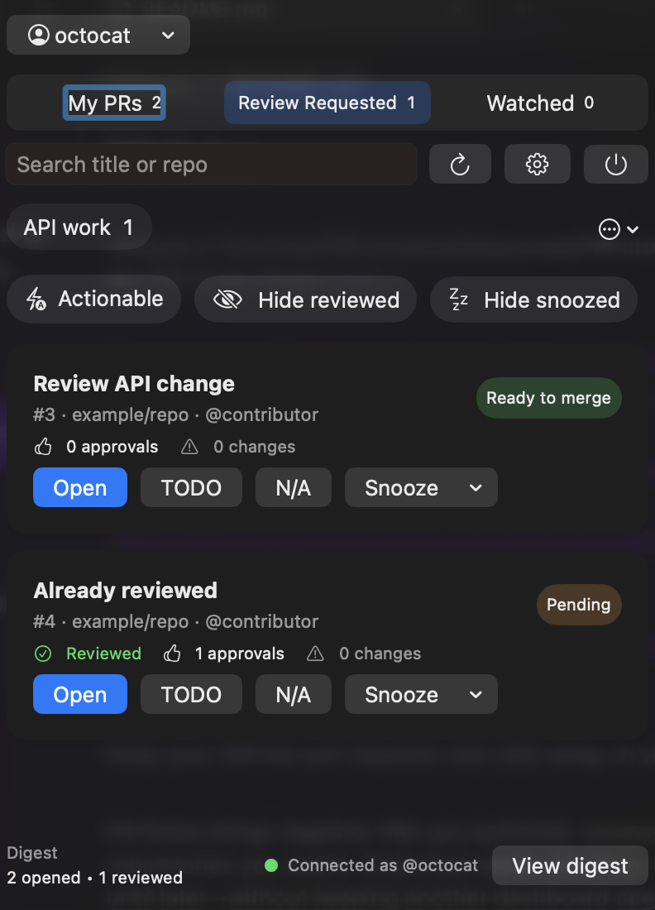
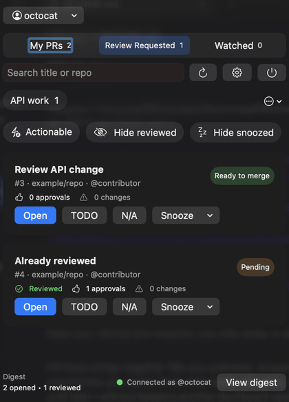
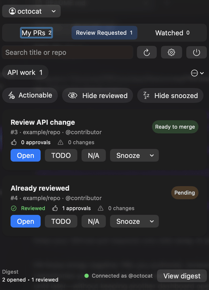
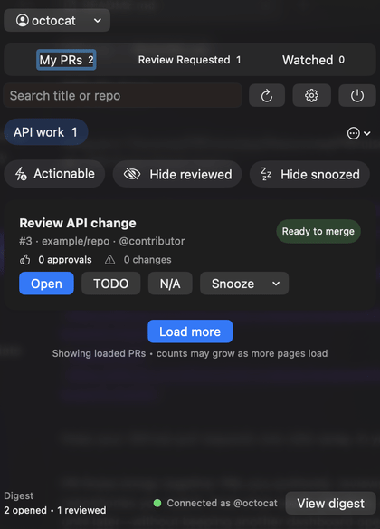
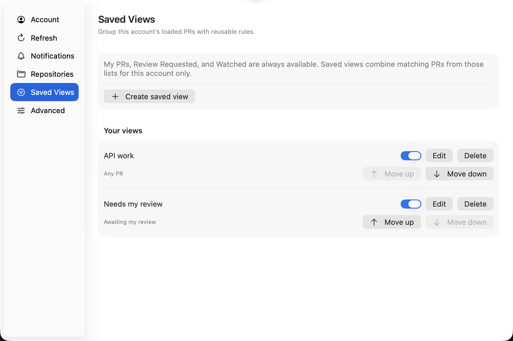
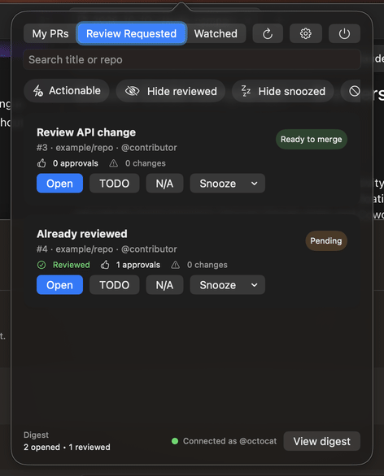
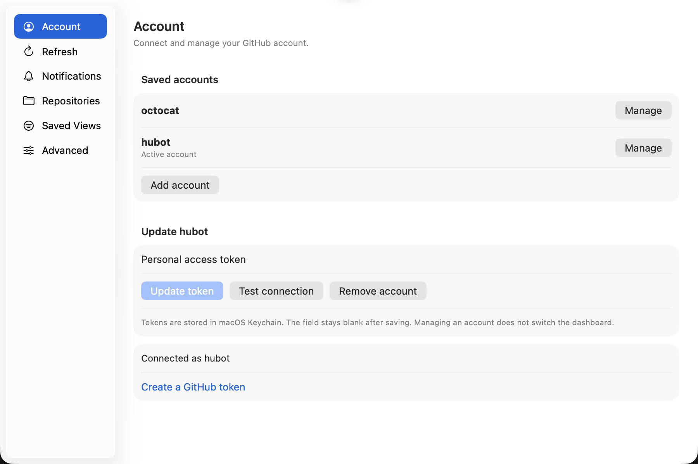

# MergeOwl


[](https://github.com/bhanurp/MergeOwl/releases/latest)
[](#install)
[](LICENSE)
[](https://github.com/bhanurp/MergeOwl/actions/workflows/test.yml)
[](https://github.com/bhanurp/MergeOwl/actions/workflows/e2e.yml)

Keep your GitHub pull requests one click away, in your Mac’s menu bar.

MergeOwl brings together PRs you authored, reviews requested from you, and repositories you watch. Switch between GitHub accounts, organize loaded PRs into saved views, and open or snooze what needs attention—without keeping another dashboard open.

[Download latest release](https://github.com/bhanurp/MergeOwl/releases/latest) · [Report a problem](https://github.com/bhanurp/MergeOwl/issues) · [Release notes](CHANGELOG.md) · [Contribute](CONTRIBUTING.md)

**MergeOwl is the new name for PR Pulse.** The transparent amber owl and MergeOwl app name are currently unreleased source changes. The latest published v0.2.1 download is still named **PRPulseApp.app** and uses the flower icon. Historical screenshots below retain their original release labels.

The rename preserves existing account profiles, settings and Keychain credentials. New releases will use **MergeOwl.app**, **MergeOwl.dmg** and **MergeOwl.zip**; existing release files keep their old names. See the [rename and upgrade guide](docs/branding-and-upgrade.md).

## A quick look

The captures below show v0.2.0. v0.2.1 keeps these account and saved-view workflows, with refreshed layouts and controls described under [Layout options](#layout-options-v021-and-newer).



Click the flower icon to open this popover. Select an account, choose a PR list or saved view, and act on a PR without opening Settings.

### Switch accounts

Open the account selector at the top, then choose a saved account. Its PRs and connection status replace the previous account's data; only one account is active at a time.



### Select a saved view

Click **API work** beneath the default tabs to show matching loaded PRs. In this example its title/repository text rule matches **Review API change**, while **Already reviewed** is excluded. Create your own rules under **Settings → Saved Views**.



[View the saved-view screenshot](docs/screenshots/popover-saved-view.png).

### Snooze and filter

Open a PR's **Snooze** menu, choose **1 hour**, then turn on **Hide snoozed**. The snoozed PR disappears from the visible list and actionable count; this does not change the PR on GitHub.



These GIFs use real native popover captures with synthetic GitHub data. They cycle through captured states (three seconds per state), not continuous recordings or browser navigation. The account and snooze guides each last nine seconds; the saved-view guide lasts six seconds. Captures are cropped to popover content to exclude desktop edges. No personal tokens or private repositories are shown.

<details>
<summary>Settings: manage accounts and create saved views</summary>


Real v0.2.0 Settings captures with synthetic GitHub data, cycling through captured states rather than a continuous recording. Only one account is active at a time; each account keeps its own saved views. No personal tokens or private repositories are shown.

### Group PRs your way



Keep **My PRs**, **Review Requested**, and **Watched**, then add account-specific views using repository, PR-state and text rules. Enabled views appear in the click-open popover; their counts cover loaded PRs only.

The new Settings images show the v0.2.0 UI with synthetic fixture data. They are window-content captures, not mockups. [v0.2.0 is available](https://github.com/bhanurp/MergeOwl/releases/tag/v0.2.0) for Apple Silicon and Intel Macs; older installations need a manual update to use accounts and saved views.

</details>

<details>
<summary>Earlier release: v0.1.5 popover and walkthrough</summary>




These older captures use synthetic GitHub fixture data. The GIF cycles through captured states rather than recording a continuous interaction. They do not show the new account selector or saved-view strip.

</details>

**Requirements:** macOS 14 or newer, an Apple Silicon or Intel Mac, and a GitHub.com account with a personal access token. No Xcode is needed for the download.

**Early release:** the app is ad-hoc signed, not Apple-notarized. Read the first-launch instructions below before installing. GitHub.com and macOS are the supported targets; GitLab, Windows, Linux, and custom GitHub Enterprise Server hosts are not supported.

## Install the current published release

1. Open the [latest release](https://github.com/bhanurp/MergeOwl/releases/latest) and download **PRPulseApp.dmg**. The universal build supports Apple Silicon and Intel.
2. Open the DMG and drag **PRPulseApp.app** into **Applications**.
3. Launch **PRPulseApp.app** from Applications.
4. Look for the orange flower icon in the menu bar at the top of your screen. Click it to open the PR list. This is a menu-bar app, not a normal Dock window.

### If macOS blocks the first launch

Because the release is not notarized, macOS may warn that it cannot verify the developer. Only proceed if you downloaded it from this repository’s Releases page and trust the software.

After attempting to open the app, go to **System Settings → Privacy & Security → Open Anyway**, then confirm **Open**. See [Apple’s instructions and security explanation](https://support.apple.com/en-us/102445). Do not disable Gatekeeper globally or override a malware warning.

Use the manual DMG installation above. Automated release installation is not recommended until publisher-authenticated artifact verification is implemented. Current releases are not notarized; downloading from this repository does not substitute for that verification.

## Connect GitHub

MergeOwl does not automatically reuse your browser or GitHub CLI login. Connect your account inside the app.

### Create a token

1. Open [GitHub’s fine-grained token settings](https://github.com/settings/personal-access-tokens/new).
2. Name the token, for example **MergeOwl**, and choose an expiration date.
3. Select the **Resource owner** that owns the repositories you want to follow. Under **Repository access**, select those repositories.
4. Set **Pull requests: Read-only**. **Metadata: Read-only** is included automatically. Additional data or organization policy may require additional access; do not grant write permissions just to dismiss a warning.
5. Generate the token and copy it. GitHub only shows its value once.

A fine-grained token is limited to one resource owner. Organization approval may be required, and some collaborator or multi-organization workflows need a classic token instead. See [GitHub’s token guide and limitations](https://docs.github.com/en/authentication/keeping-your-account-and-data-secure/managing-your-personal-access-tokens).

For a classic token, use [GitHub’s classic token settings](https://github.com/settings/tokens). Private-repository access uses the broad `repo` scope; organization visibility may need `read:org`. These scopes are broader than read-only access: use a fine-grained token where possible, follow your organization’s policies, and authorize SSO access if required.

### Save and verify the connection

1. Click the flower menu-bar icon, then **More (…) → Settings**. On v0.2.0, use the **gear** button instead.
2. Select **Account** in the sidebar.
3. Paste the token into **Personal access token**.
4. Click **Connect GitHub** (or **Update token** if already configured).
5. Wait for **Connected as `<your username>`**. Return to the popover and click the **refresh** button.
6. Choose **My PRs** or **Reviews** (called **Review Requested** in the Compact picker and v0.2.0). An empty list can be correct if you have no matching open PRs.

**Test connection** checks a token but does not save a newly entered token. If the status says **Token verified — save to connect**, click **Connect GitHub** or **Update token** to persist it.

Tokens are stored in macOS Keychain, not plaintext settings. The input intentionally becomes blank after saving and when Settings reopens; this does not mean the saved token was lost. Check the connection status or use **Test connection** without entering a token.

An active account session reuses its token in memory rather than reading Keychain for every API request. Switching accounts or relaunching retrieves that account’s saved credential again. macOS may still request access after an app identity/signature change; this early release does not eliminate signing-related prompts.

### Multiple accounts (v0.2.0 and newer)

The account and saved-view workflows below require v0.2.0 or a source build containing these features. v0.1.5 and earlier support one saved token.

1. Open **Settings → Account → Add account**, enter the other account’s token, and click **Connect GitHub**.
2. Use the account menu above the PR tabs to select the account to display. Only one account is loaded at a time; adding another does not switch away from an existing active account.
3. To replace a token, click **Manage** beside that account, enter the replacement, and choose **Update token**. A token belonging to another GitHub identity must be added as a separate account.

Accounts have separate watched repositories, TODO/N/A marks, snoozes, activity and saved views. Refresh and notification preferences are shared. Selection persists after relaunch. Re-adding the same GitHub user updates its credential instead of creating a duplicate profile.



**Manage** edits an account's token; the popover's account menu selects which account to display. A blank token field is intentional—the saved token stays in Keychain.

Existing single-account data is copied only after GitHub verifies the legacy token. Original files and the legacy credential remain as a recovery backup. If migration fails, use **Retry account setup** after checking network and Keychain access; do not delete your data as a workaround.

**Remove account** requires confirmation and removes that profile’s credential and local data, not the GitHub account or repositories. The first remaining account becomes active when the active account is removed. The legacy migration backup is retained; revoke obsolete tokens on GitHub when no longer needed.

## Use MergeOwl

### Layout options (v0.2.1 and newer)

MergeOwl supports two popover layouts. **Tabbed (B)** is the default: PR tabs and saved-view shortcuts remain visible. **Compact (A)** puts default lists and saved views in one view picker, leaving more room for PRs.

Use **More (…) → Layout → Tabbed / Compact**, or open **More → Settings → Appearance** for layout previews. The choice is saved automatically across restarts and applies to every account. Changing layout keeps the active account, selected view, search, filters and local triage unchanged. Search, tab and refresh keyboard shortcuts work in both layouts.

**More** also contains Settings and Quit; **Filters** contains Hide reviewed, Hide snoozed and Hide N/A. Click a PR title to open GitHub, use **Snooze** directly, or use its **More PR actions** menu for **Mark to do**, **Mark not relevant** and **Clear override**. **Activity** opens the digest. The footer counts visible loaded PRs; the menu-bar badge still covers all loaded lists.

These layout changes are not in v0.2.0. The captures above show that earlier interface; the installation and connection instructions describe v0.2.1 and note older controls where needed.

### Find the PRs that matter

- **My PRs:** open PRs authored by you.
- **Reviews / Review Requested:** open PRs requesting your review.
- **Watched:** open PRs in repositories added under **Settings → Repositories**. Enter `owner/repo`, for example `apple/swift`, and click **Add**.

Search by title or repository. Use **Actionable** and **Filters → Hide reviewed / Hide snoozed / Hide N/A** to narrow the list. On v0.2.0 these filters appear directly in the popover. If PRs seem missing, clear search and turn off filters first.

The menu-bar badge counts actionable PRs. Click the icon to see the list; the PR list is not displayed directly in the menu bar.

### Create saved PR views (v0.2.0 and newer)

Open **Settings → Saved Views → Create saved view**. Give it a unique name (1–40 characters), optionally enter exact `owner/repo` names separated by commas, choose a PR-state rule, and optionally match text in the title or repository. All supplied rules must match. **Cancel** leaves the existing definition unchanged.

In Tabbed layout, enabled saved views appear beneath the default tabs. Use **All saved views** to reach names outside the scrollable strip. In Compact layout, select them in the view picker. In Settings you can edit, reorder, disable or delete views; the three default PR lists remain available. Views belong only to the selected account.

Saved views combine the PRs already loaded from My PRs, Review Requested and Watched. Counts cover **loaded data**, not every PR on GitHub. **Refresh** fetches the first page of each source; **Load more** fetches another page from sources that have more results. PRs shared by several lists or views count once in the global badge. Snoozed and N/A PRs do not count as actionable, and search filters do not change the badge.

With the popover active, use **Command-1/2/3** for the default tabs, **Command-F** for search and **Command-R** to refresh. These are app-scoped shortcuts, not global hotkeys.

### Triage without changing GitHub

Click a PR title to open it on GitHub, use its **More PR actions** menu to **Mark to do** or **Mark not relevant**, or use **Snooze** to defer it. On v0.2.0, use **Open**, **TODO** and **N/A** instead. Triage and snooze are local app actions; they do not submit a GitHub review or merge a PR.

### Tune refresh and notifications

**Available in source, unreleased:** CI monitoring adds check status in both layouts, optional failure alerts for all accessible open My PRs, and persistent per-PR mutes. It was merged in PR #18 and is not in the v0.2.1 download. See the [CI monitoring guide](docs/ci-monitoring.md) for controls and limits.

- **Settings → Refresh:** choose the refresh interval and whether to refresh on launch.
- **Settings → Notifications:** configure re-review and new-review-request alerts, digest cadence, and default reminder time. Allow notifications in macOS System Settings if prompted.
- **Activity:** open the activity summary from the popover footer (**View digest** on v0.2.0).
- **Settings → Advanced:** refresh immediately, test a notification, or export diagnostics.

## Troubleshooting

| What you see | What to do |
| --- | --- |
| No icon or app window | Launch `PRPulseApp.app` from Applications and check the first-launch warning. Look in the menu bar, including any hidden-items area managed by a menu-bar utility. |
| **Couldn’t connect to GitHub** or a 401 error | Check token expiration/revocation, paste a replacement under **Account**, and click **Update token**. |
| Connected, with an orange access warning | Authentication succeeded, but some PR data is inaccessible. Accessible PRs remain visible. Check repository selection, organization approval, and SSO authorization; see details under **Account**. |
| No pull requests | Clear search/filters, refresh, and check the selected tab. **Watched** requires configured repositories. Compare with open PRs visible to your account on GitHub. |
| Token field is blank after relaunch | This is intentional. Check the connection status or use **Test connection** without entering a token. |
| Repeated Keychain prompts | Use one installed app copy; development and release builds can have different identities/signatures. Do not delete your Keychain as a workaround. Report persistent prompts. |
| Two Settings windows on v0.1.5 or earlier | The activation issue is tracked in [#9](https://github.com/bhanurp/MergeOwl/issues/9). Close the extra window and use the popover’s gear button. The v0.2.0 source uses one retained native preferences window. |
| Notifications do not arrive | Check macOS notification permission and **Settings → Notifications**. Live OS delivery is not covered by automated fixture tests. |

Still stuck? [Open an issue](https://github.com/bhanurp/MergeOwl/issues) with your macOS version, app release version, reproduction steps, and error text. Redact tokens, private repository names, and sensitive information from screenshots or exported logs. Never paste a token into an issue.

## Update or uninstall

To update, quit PR Pulse using **More → Quit PR Pulse** (the power button on v0.2.0), download the latest DMG, replace the app in Applications, and launch it again. App replacement does not intentionally remove your Keychain token or local preferences.

Once a MergeOwl-branded release is published, quit the old app first and install **MergeOwl.app**. Verify your saved accounts in MergeOwl, then remove the old PRPulseApp application copy to avoid launching two menu-bar apps. Do not delete account data or Keychain entries during the rename.

To uninstall, remove each saved account in **Settings → Account** first, then quit and move **PRPulseApp.app** to Trash. On v0.1.5 and earlier, use **Remove token** instead. Revoke tokens on GitHub if no longer needed, including any retained legacy migration token. Removing the app alone does not remove Keychain credentials, migration backups or local preferences.

## Current scope and roadmap

The source includes three PR lists, actionable badge, search and filters, local triage, snooze, watched repositories, refresh/notification preferences, digest, Keychain-backed account profiles and account-specific rule-based saved views. See the version notes above when using an older downloaded build.

**Deferred:** [secure automatic updates](docs/superpowers/specs/2026-10-11-secure-auto-updates-design.md), Developer ID signing and notarization. Updates still require manual DMG replacement. Manual per-PR collections, team sharing and cloud sync are not implemented. See the [product roadmap](docs/superpowers/specs/2026-09-12-prpulse-public-product-roadmap-design.md), [open issues](https://github.com/bhanurp/MergeOwl/issues), and [changelog](CHANGELOG.md). Roadmap items are intentions, not promises of availability.

## Build and test from source

Source builds require macOS 14+ and Swift 6.2 or newer. Native UI tests also require full Xcode, a logged-in desktop, and XcodeGen.

```bash
git clone https://github.com/bhanurp/MergeOwl.git
cd MergeOwl
swift test
bash scripts/install_prpulse.sh
open "$HOME/Applications/MergeOwl.app"
```

The installer builds and packages a local development app. Its bundle identity/version metadata differs from the published release; do not treat it as the official downloaded build or run both copies together.

Installer regression tests:

```bash
bash Tests/InstallerTests/test_install_latest_release.sh
bash Tests/InstallerTests/test_install_prpulse.sh
```

Native end-to-end tests:

```bash
brew install xcodegen
bash scripts/test_e2e.sh
```

Read the [E2E guide](Tests/E2E/README.md) first: UI tests control the desktop. CI exercises isolated GitHub fixtures, not your account. These tests do not prove live organization SSO, external browser navigation, or macOS notification delivery.

## Contribute and support

Read [CONTRIBUTING.md](CONTRIBUTING.md) for development and PR expectations, and [SECURITY.md](SECURITY.md) for vulnerability reporting. MergeOwl is available under the [MIT license](LICENSE).

Found MergeOwl useful? Star the repository to help other developers discover it. Reproducible bug reports, onboarding feedback, and documentation fixes are equally welcome.
